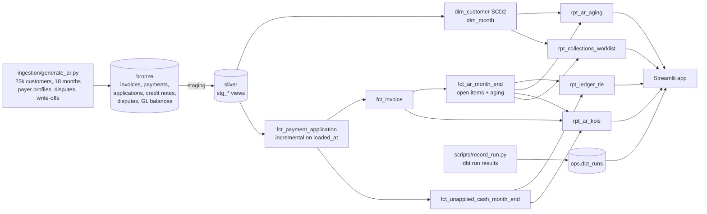

# Receivables & Cash Analytics App

[](https://github.com/Saigwe/receivables-analytics-app/actions/workflows/ci.yml)

> One live view of receivables: aging, DSO, CEI, unapplied cash and a collections worklist from a dbt model of 660k invoices, served in a Streamlit app that proves on every screen that the sub-ledger ties to the general ledger.

**Author:** Stanley Igwe, Lead Data (Analytics) Engineer · [Portfolio](https://saigwe.github.io)
**Stack:** Python · dbt Core (incremental models, type-2 dimension, unit tests) · DuckDB · Streamlit · GitHub Actions
**Status:** Core build complete and run at full scale (25,000 customers, 18 months). See [Roadmap](#roadmap) for the Snowflake run and hosted demo.

Based on accounting-analytics work I did at a US food-delivery company, where I moved 10+ Tableau AR reports to Streamlit on dbt for one live view of $700M+ of receivables. This repo rebuilds the problem end to end on **synthetic data**; no employer data, code or logic is used.

---

## 90-second summary
| | |
|---|---|
| **Problem** | AR teams work from reports that disagree. Aging comes from one tool and DSO from another, nobody can show the numbers tie to the GL, and collectors don't know who to call first. |
| **What I built** | A layered dbt model of the AR sub-ledger: month-end open items with aging, unapplied cash, a GL tie-out, KPIs (DSO, CEI, share over 60 days, dispute rate, write-offs) and a ranked collections worklist. A Streamlit app sits on top. |
| **Why it matters** | One definition of every AR number, a "ties to ledger" check on every screen, and a worklist that puts the money most at risk first. |
| **Proof** | All 54 month-end and currency tie-outs to the GL balance to the cent. dbt runs 59 checks (unit, data and business-rule tests) in about 4 s, and the incremental model provably equals a full rebuild. See [Numbers](#numbers). |

## Architecture


## Data model (gold layer)
| Model | Grain | Purpose |
|---|---|---|
| `dim_customer` | customer version | type-2 history of segment, terms and credit limit (`valid_from` / `valid_to`) |
| `dim_month` | month-end | the close calendar |
| `fct_payment_application` | cash application | payment applied to an invoice. Incremental on load time, so late-loading payments are picked up |
| `fct_invoice` | invoice | credits, cash applied, open amount, settlement date, days late, dispute flag |
| `fct_ar_month_end` | invoice × month-end (while open) | open balance and aging bucket at each month-end, the basis of every AR number |
| `fct_unapplied_cash_month_end` | payment × month-end | cash received but not yet applied |
| `rpt_ledger_tie` | month-end × currency | sub-ledger net AR (open items minus unapplied cash) vs GL account 1200 |
| `rpt_ar_aging` | month-end × segment × bucket | aging by the segment the customer had **at that month-end** (point-in-time join to the SCD2 dimension) |
| `rpt_ar_kpis` | month-end | net AR, sales, DSO, CEI, share over 60, dispute rate, write-offs, days to settle |
| `rpt_collections_worklist` | customer | overdue, over 60, credit-limit use, open disputes, recent lateness, priority rank |

**KPI definitions** (defined once, in `rpt_ar_kpis`):
- **DSO** = net AR ÷ credit sales of the last 3 months × days in those months.
- **CEI** = (opening AR + sales − closing AR) ÷ (opening AR + sales − closing current AR) × 100.

## The app
`make app` starts Streamlit on the warehouse. Every page opens with the ledger tie-out (green when the sub-ledger equals the GL in every currency). There are five tabs:
- **Overview:** KPIs with month-on-month change, plus net AR, sales, DSO and CEI trends.
- **Aging:** open AR by bucket and segment at any month-end.
- **Collections:** a ranked worklist with credit-limit use, and a drill-down into a customer's open invoices.
- **Ledger tie:** sub-ledger vs GL in local currency.
- **Pipeline health:** last dbt build, failures, build time, payment freshness and the slowest models (project 4 of my plan, folded in here).

## Tests
- **GL tie-out:** `assert_subledger_ties_to_gl` fails the build if any month-end or currency is off by a cent or more.
- **Cash application:**
  - cash is never applied before it arrives
  - no payment is over-applied
  - no invoice is over-settled
- **Totals:** the aging report adds up to the open-item fact at every month-end, so no invoice is lost in the type-2 join.
- **KPI ranges:**
  - DSO isn't negative
  - shares are proportions
  - CEI is between 0 and 100
- **Unit tests:**
  - type-2 validity windows close the day before the next change
  - open balance and aging bucket follow credits and cash month by month: 90 current, then 40 at 1–30 days, then settled
- **Incremental equals full refresh** (`scripts/check_incremental.py`):
  1. Load to a cutoff.
  2. Run incrementally.
  3. Full-refresh and compare both results with `EXCEPT` in each direction.

## Numbers
From real runs on a Windows laptop (DuckDB, dbt 1.11). Reproduce with `make all`; the data is deterministic (seed 7).

| Metric | Value |
|---|---|
| Customers / customer versions | 25,000 / 27,000 |
| Invoices / payments / cash applications | 659,016 / 650,724 / 650,406 |
| Credit notes, including bad-debt write-offs / disputes | 32,932 (7,252 write-offs) / 19,031 |
| Open-item rows (invoice × month-end) | 1,038,199 |
| Generate data / `dbt build` | 8 s / 3.9 s, all 59 checks passing (about 14 s wall clock with dbt start-up) |
| Month-end × currency tie-outs to GL | **54 / 54 tied to the cent** |
| Incremental run vs full rebuild | equal on 650,406 rows, including 35 applications that loaded after the cutoff |
| Applications made after the cash arrived (unapplied cash) | 19,069 |

**Position at 30 June 2025 (USD):**

| Net AR | Sales (month) | DSO | CEI | Over 60 days | Unapplied cash | Write-offs (month) | Dispute rate | Avg days to settle |
|---|---|---|---|---|---|---|---|---|
| $171.97M | $87.62M | 60.1 days | 65.4% | 4.8% | $0.66M | $1.46M | 2.8% | 50.2 |

| Aging bucket | current | 1–30 | 31–60 | 61–90 | 91–120 | 120+ |
|---|---|---|---|---|---|---|
| Open AR (USD) | $126.89M | $28.96M | $8.53M | $3.34M | $1.75M | $3.17M |

The worklist ranks the 9,483 customers with overdue balances. These numbers come from the generator's assumptions (payer mix, terms, write-off policy); they show the model working at scale, not a benchmark of any real business.

## How to run
Requires **Python 3.12** (what CI uses) and `make`, or run the commands in the `Makefile` by hand.
```bash
python -m venv .venv && source .venv/bin/activate   # Windows: .venv\Scripts\activate
pip install -r requirements-app.txt
make all          # generate 25k customers -> dbt build -> record run -> incremental check
make app          # Streamlit on http://localhost:8501
make fixture-all  # 300 customers, 6 months (CI)
```

## Roadmap
- [x] Synthetic AR sub-ledger and GL with payer profiles, partial payments, cash-application lag, disputes, write-offs and late loads
- [x] SCD2 customer dimension, incremental cash-application fact, month-end open items, KPIs, GL tie-out, collections worklist
- [x] Streamlit app with a tie-out banner and pipeline-health tab (project 4 folded in)
- [x] Unit, data, business-rule and incremental tests in CI; full-scale run
- [ ] Snowflake run (trial account), with runtime and credits; Streamlit in Snowflake version
- [ ] Hosted demo on Streamlit Community Cloud, with app screenshots in this README
- [ ] Cost per model from warehouse query history, and month-end close alerts to Slack
- [ ] Design doc and a 3-minute Loom walkthrough

## Interview topics this project prepares
- Dimensional modelling: grain, point-in-time joins to a type-2 dimension
- Incremental models on load time, and proving them against a full refresh
- AR metrics (DSO, CEI, aging) and why one definition matters
- Reconciling a sub-ledger to the GL
- Building analytics apps on top of dbt

## Data and licence
- **Data:** fully synthetic, generated with a fixed seed by `ingestion/generate_ar.py`. Customers, amounts and behaviours are invented and don't describe any real company.
- **Code:** MIT (see `LICENSE`).
