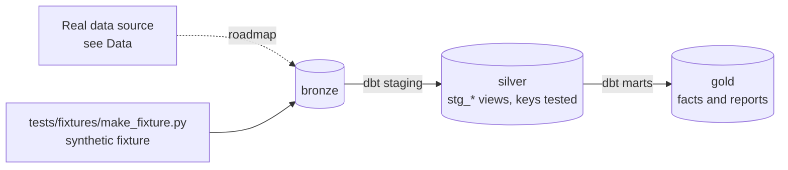

# Receivables & Cash Analytics App

[](https://github.com/Saigwe/receivables-analytics-app/actions/workflows/ci.yml)

> One live view of receivables: AR aging, DSO and collections on dbt, served in a Streamlit app, with cost and pipeline-health monitoring built in.

**Author:** Stanley Igwe, Lead Data (Analytics) Engineer · [Portfolio](https://saigwe.github.io)
**Stack:** Snowflake (trial) or DuckDB · dbt Core · Streamlit · Elementary (dbt observability) · GitHub Actions
**Status:** 🚧 Scaffolded. Fixture pipeline passes: `dbt build` 20/20. See [Roadmap](#roadmap).

Project 1 of my portfolio plan. In accounting analytics at a US food-delivery company I moved 10+ Tableau AR reports to Streamlit in Snowflake on dbt, giving one live view of $700M+ of receivables across ~25k customers. I also built Snowflake cost and connector-health monitoring. This repo rebuilds the problem on public and synthetic data. No employer or client data, code or logic is used.

---

## 90-second summary
| | |
|---|---|
| **Problem** | TODO: one sentence on the business problem. |
| **What I built** | TODO: fill in as the roadmap lands. |
| **Why it matters** | TODO: the decision this enables, in the user's words. |
| **Proof** | TODO: link to [Numbers](#numbers), with every claim reproducible. |

## Architecture


## Data
Synthetic customers, invoices and payments from a Python generator: partial payments, unapplied cash, disputes and mixed currencies. No public dataset has real AR detail, so the generator is the real-data path too. Scale it to 25k customers with `--scale`.

| Bronze table (fixture) | Rows |
|---|---|
| `bronze.customers` | 300 |
| `bronze.invoices` | 3,000 |
| `bronze.payments` | 2,400 |

## Data model (gold layer, first cut)
| Model | Purpose |
|---|---|
| `fct_ar_open_items` | One row per invoice issued by as_of_date, with its open balance and aging bucket at that date. |
| `rpt_ar_aging` | AR aging by customer segment and bucket at as_of_date. |

## Tests in place
- Staging: `unique` / `not_null` on every key, and `relationships` on every foreign key
- Marts: grain tests (`unique_combination`) and accepted values
- Business rules: `assert_payments_do_not_exceed_invoice`

## Numbers
*(Fill from real runs. Never estimate.)*
| Metric | Value |
|---|---|
| Rows processed (real data) | _tbd_ |
| dbt models / tests | _tbd_ |
| `dbt build` runtime | _tbd_ |

## How to run
Requires **Python 3.12** (what CI uses) and `make`, or run the commands in the `Makefile` by hand.
```bash
python -m venv .venv && source .venv/bin/activate   # Windows: .venv\Scripts\activate
pip install -r requirements.txt
make fixture-all   # synthetic fixture -> dbt build (used in CI)
```

## Roadmap
- [x] Scaffold: synthetic fixture, staging with key tests, first marts and business-rule tests, CI
- [ ] Model `fct_invoice`, `fct_payment_application` and `dim_customer` (SCD2 with dbt snapshots) with an explicit grain
- [ ] AR metrics: aging buckets, DSO, collection effectiveness index, dispute rate
- [ ] Make the payment fact incremental with `merge`, plus a late-arriving payments test
- [ ] Streamlit app: filters, drill-down to invoice, a 'ties to ledger' banner
- [ ] Fold in project 4: cost per model and team, freshness SLAs and failure trends from dbt artifacts, with an Elementary report and a month-end Slack alert
- [ ] Run on Snowflake and record run time and credits
- [ ] Fill in [Numbers](#numbers) and the [design doc](docs/design_doc.md)
- [ ] 3-minute Loom walkthrough

## Interview topics this project prepares
- Dimensional modelling and grain
- Incremental models and late data
- AR metrics (DSO, CEI)
- FinOps and observability

## Data and licence
- **Fixture:** synthetic, generated with a fixed seed by `tests/fixtures/make_fixture.py` from `fixture_spec.yml`. It describes no real company or person.
- **Real data:** see [Data](#data) for each source's own licence and terms.
- **Code:** MIT (see `LICENSE`).
